# Lab 63 — Complete Proof Gallery

All **17 outputs** below are regenerated from the submitted Lab 63 source on GitHub Actions and committed to this folder. The submitted Python source is the same plotting program with **74 full-line comments removed**.

The uploaded images and PDF were reviewed. CI-generated versions may differ in pixel compression, layout or fonts from those uploaded originals; these are reproducible charts, not claimed byte-identical replacements.

## Sales dashboard

[Full-resolution PNG](sales_dashboard.png) · [JPG version](sales_dashboard.jpg) · [PDF report](sales_dashboard.pdf)

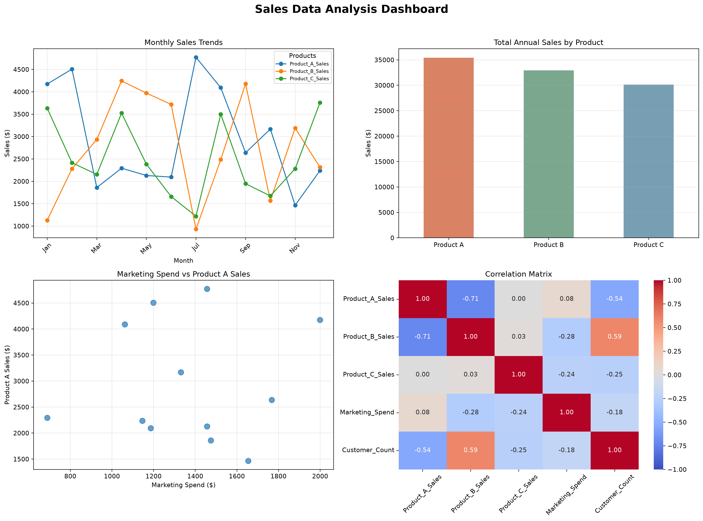

## Task-by-task proof

| Task | Output | Link |
|---|---|---|
| Task 2 | Single-product line chart | [product_a_sales.png](product_a_sales.png) |
| Task 2 | Multiple-product line chart | [all_products_sales.png](all_products_sales.png) |
| Task 2 | Annual sales bar chart | [annual_sales_bar.png](annual_sales_bar.png) |
| Task 2 | Horizontal marketing spend bars | [marketing_spend_barh.png](marketing_spend_barh.png) |
| Task 3 | Customized three-line chart | [customized_line_chart.png](customized_line_chart.png) |
| Task 3 | Grouped colored bars | [customized_bar_chart.png](customized_bar_chart.png) |
| Task 4 | Four histogram panels | [histograms.png](histograms.png) |
| Task 4 | Four scatter plot panels | [scatter_plots.png](scatter_plots.png) |
| Task 5 | Correlation matrix data | [correlation_matrix.csv](correlation_matrix.csv) |
| Task 5 | Matplotlib + Seaborn heatmaps | [correlation_heatmaps.png](correlation_heatmaps.png) |
| Task 5 | Correlation strength bar plot | [correlation_strengths.png](correlation_strengths.png) |
| Task 6 | Dashboard PNG | [sales_dashboard.png](sales_dashboard.png) |
| Task 6 | Dashboard JPG | [sales_dashboard.jpg](sales_dashboard.jpg) |
| Task 6 | Dashboard PDF | [sales_dashboard.pdf](sales_dashboard.pdf) |
| Task 6 | Individual sales trends | [monthly_sales_trends.png](monthly_sales_trends.png) |
| Task 6 | Marketing scatter and trend | [marketing_effectiveness.png](marketing_effectiveness.png) |
| Task 6 | Sales distributions | [sales_distributions.png](sales_distributions.png) |

<b>Expand all chart previews</b>

### Basic plots

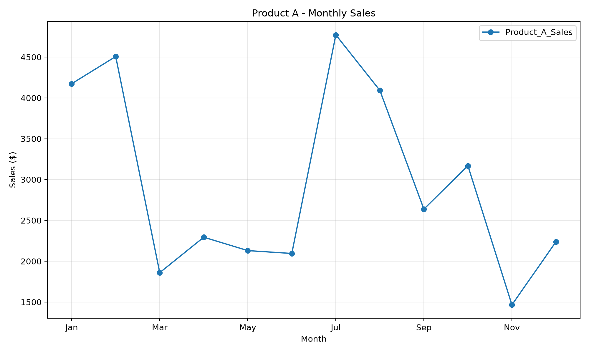
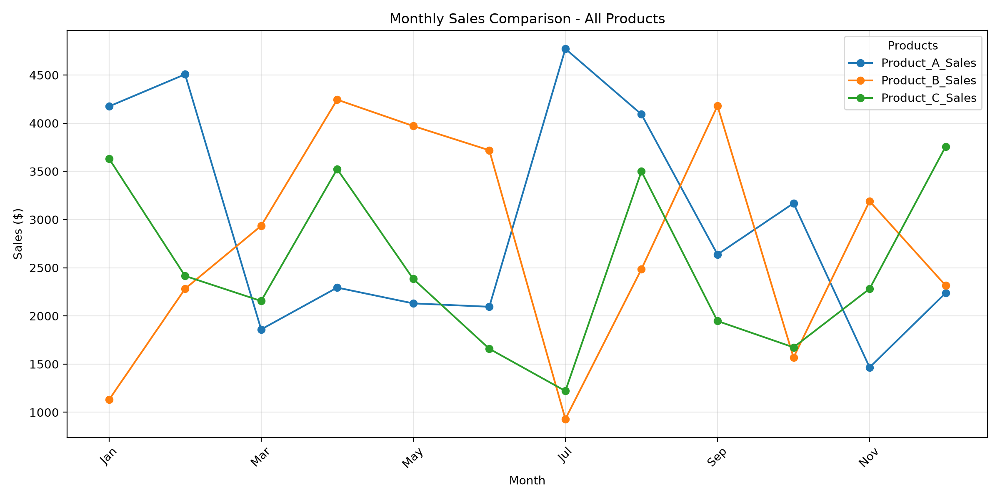
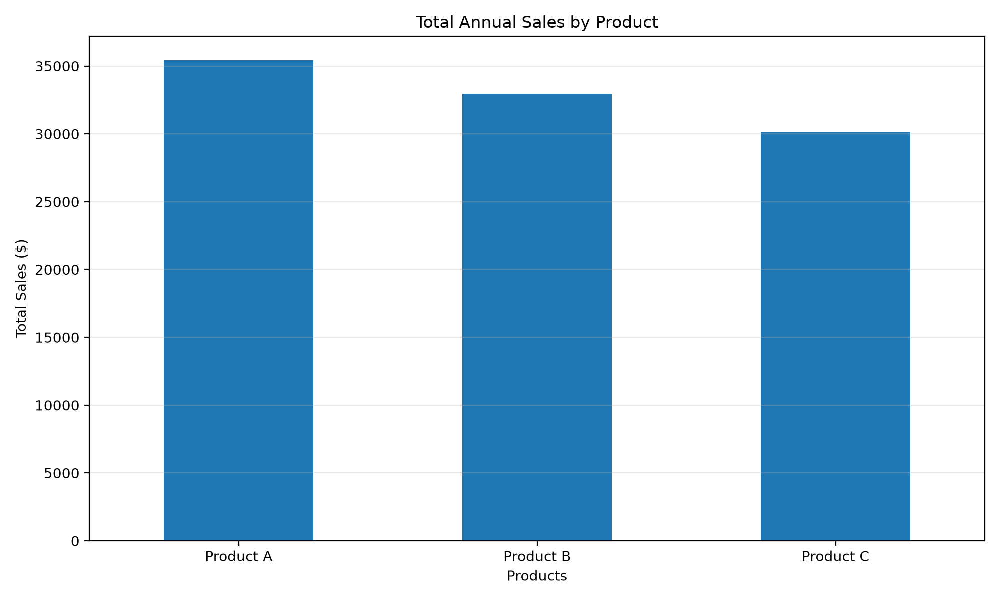
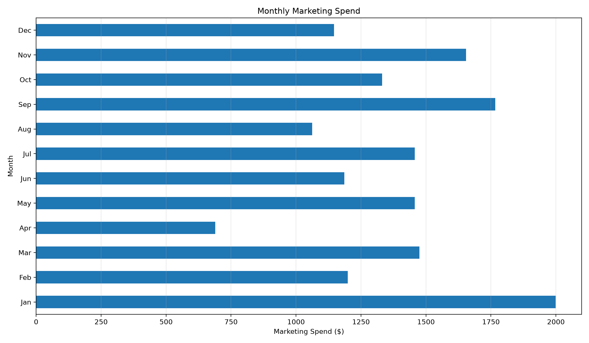

### Customized charts

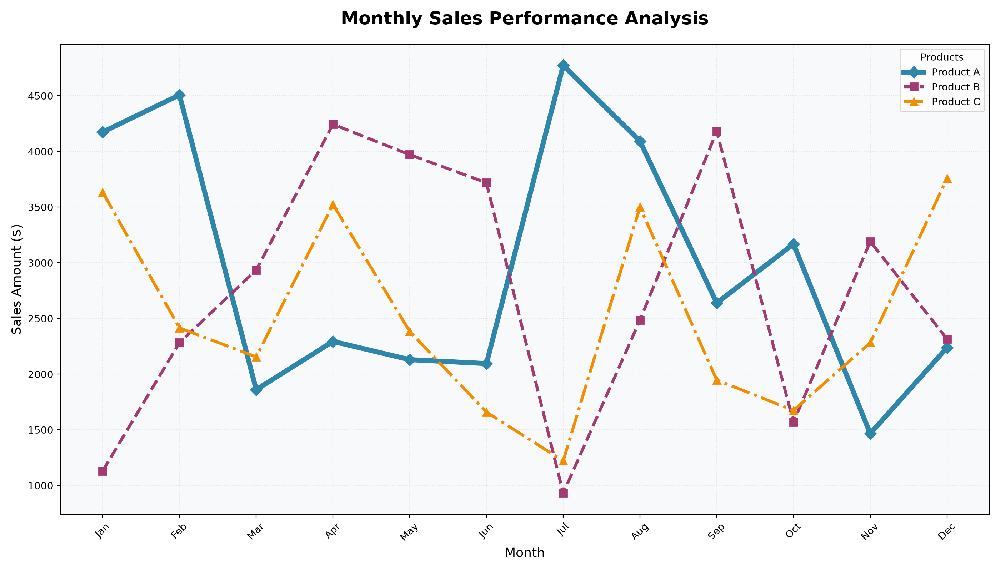
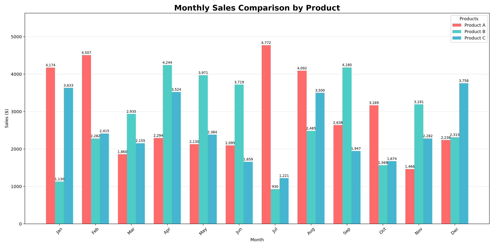

### Advanced graphs

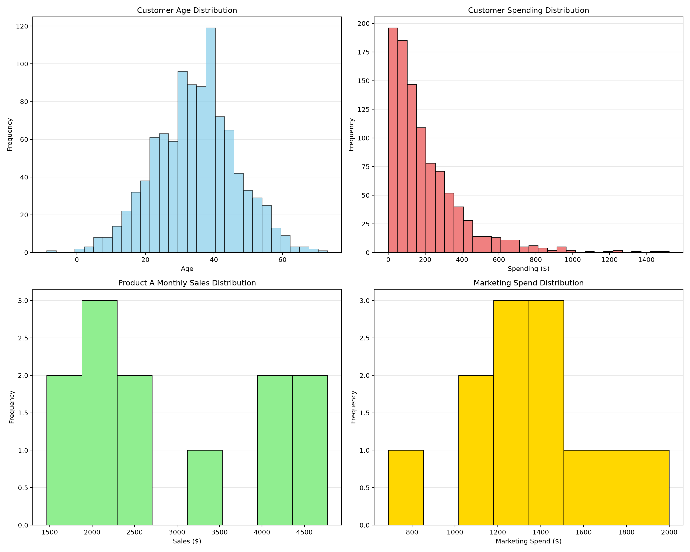
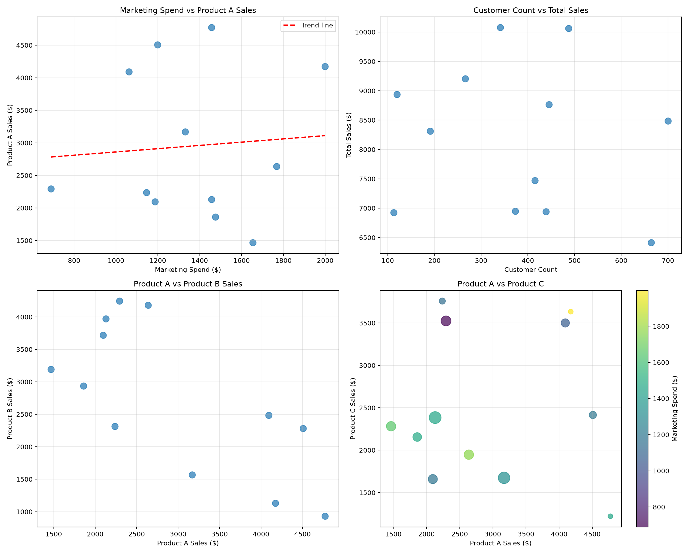

### Correlations

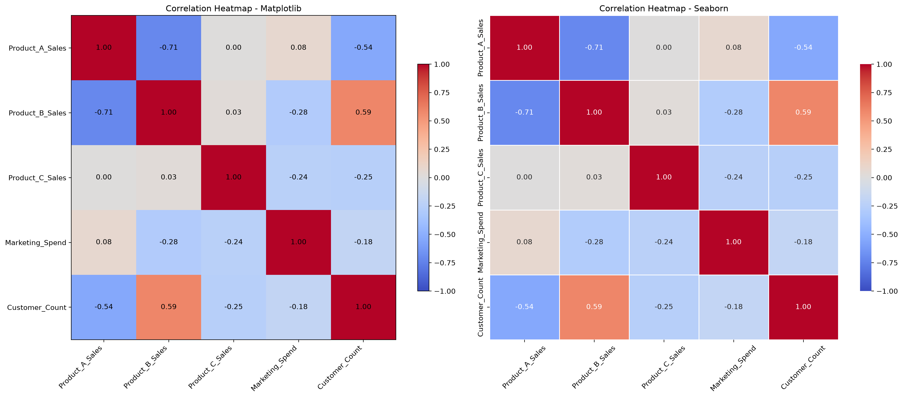
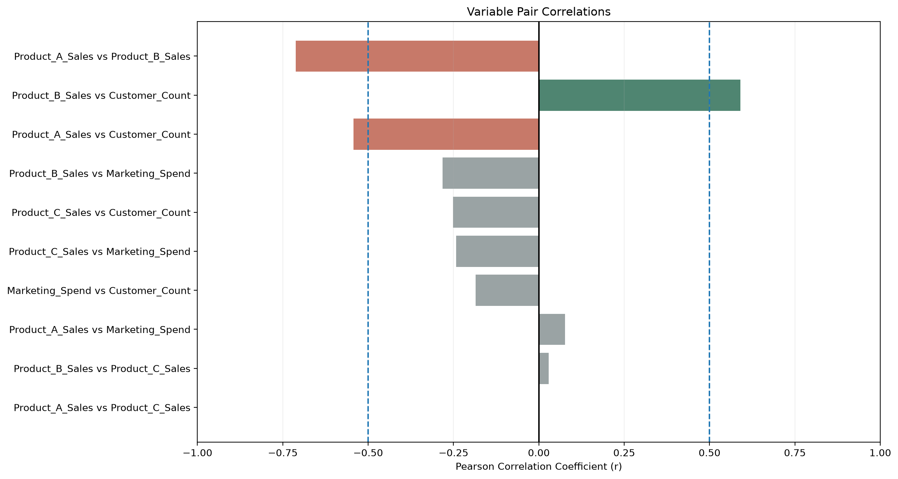

### Final individual exports

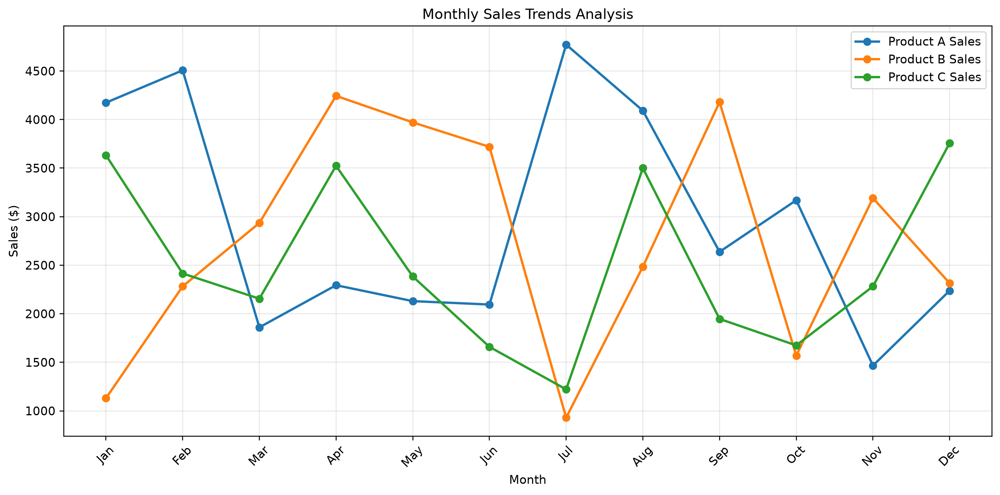
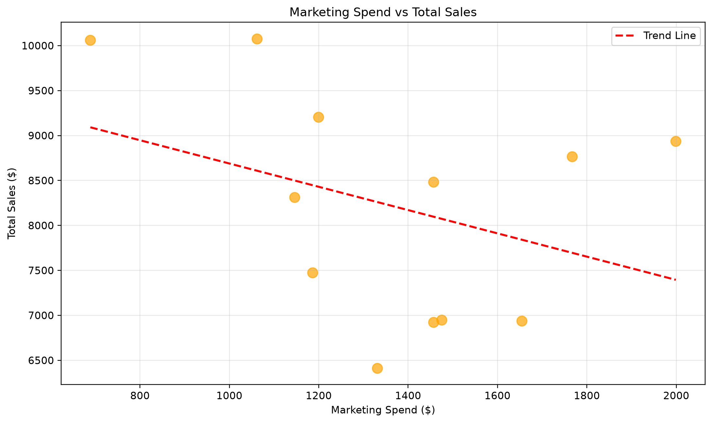
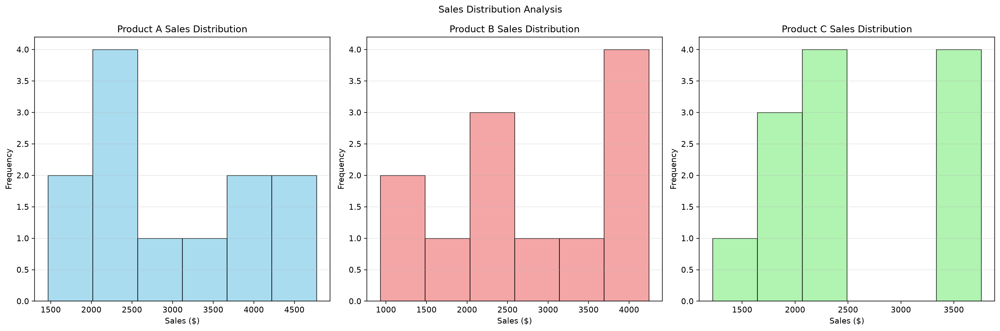

**Educational dataset:** These are simulated monthly values. Correlations do not establish causal effects.
